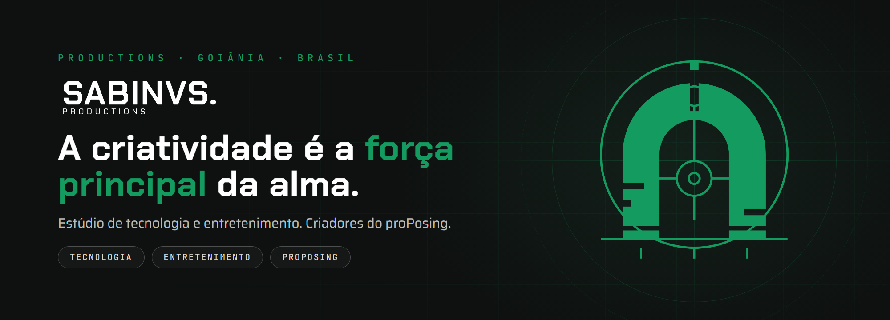

### A criatividade é a força principal da alma.

A **SABINVS PRODUCTIONS** é um estúdio de Goiânia que junta **tecnologia** e **entretenimento**. A gente cria produto do zero, da ideia à tela, e gosta de mostrar como faz.

#### O que estamos criando

**[proPosing](https://github.com/proposingapp)** · o seu computador vira o seu coach de pose. 
Visão computacional que corrige a pose de fisiculturismo em tempo real, articulação por articulação. Piloto fechado no desktop, mobile a caminho.

 

#### Quem faz

| | |
|---|---|
| **Luiz Sabino** | Founder |
| **Igor Ferreira** | Co-Founder |
| **Haryston Daniel** | Head of Infrastructure |

---

SABINVS PRODUCTIONS · Goiânia, Brasil
